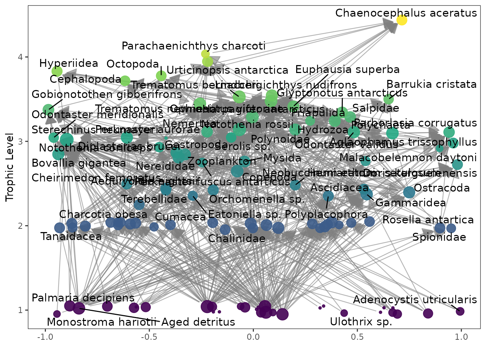
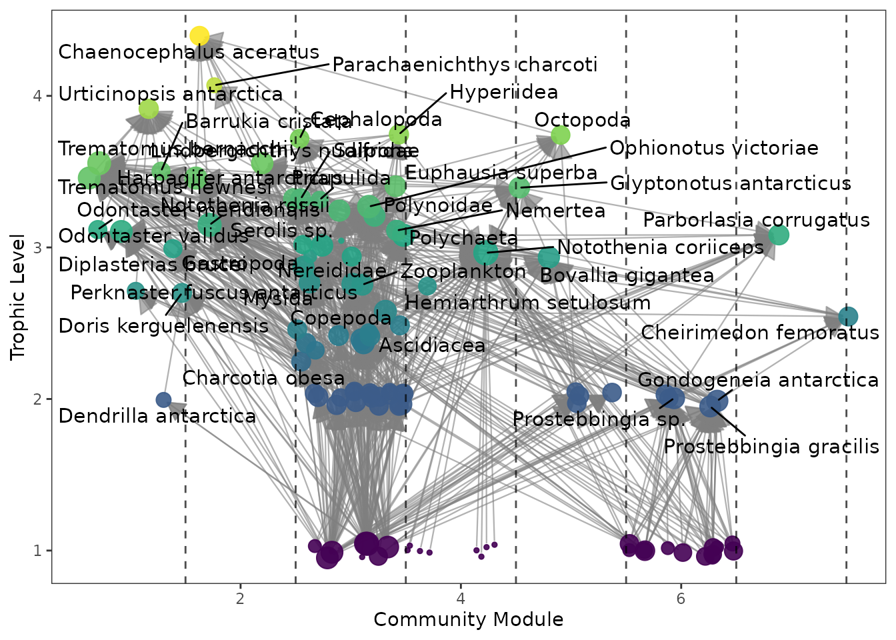
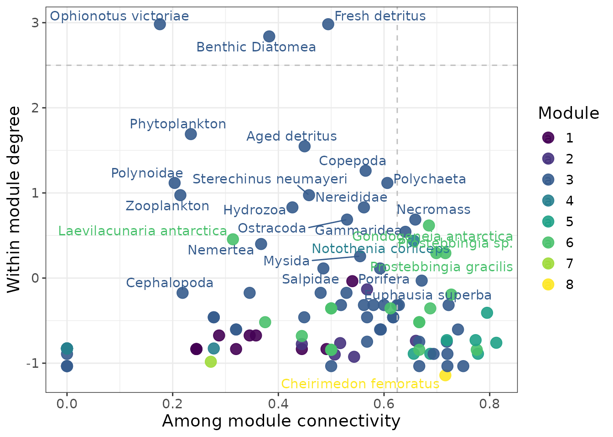
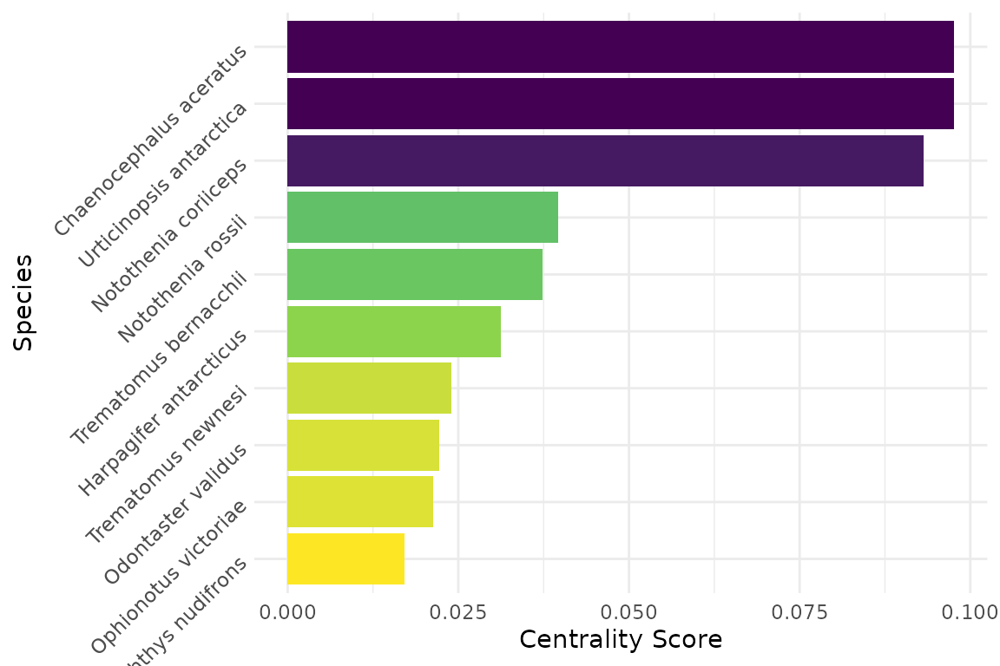
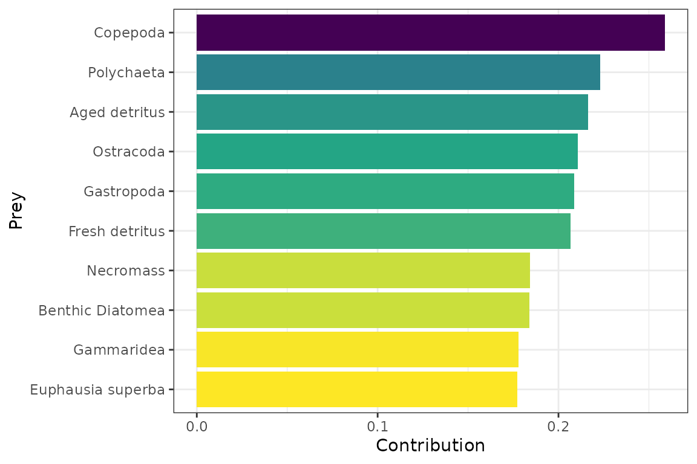
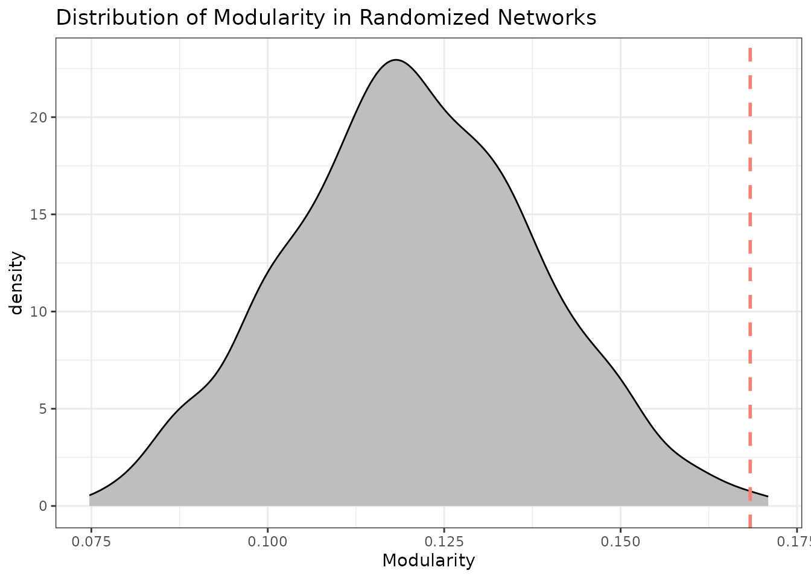
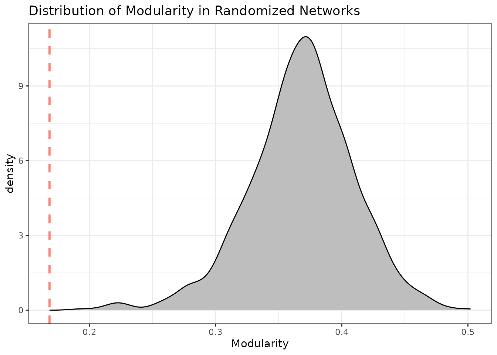
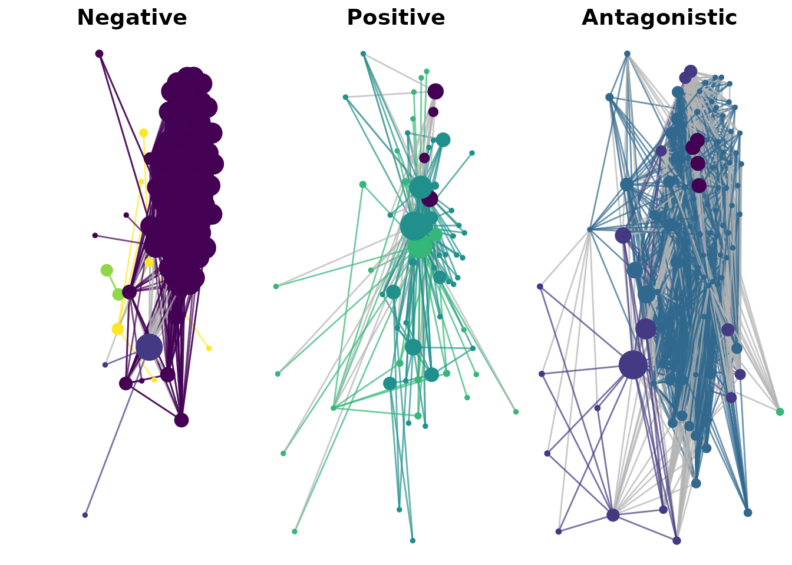
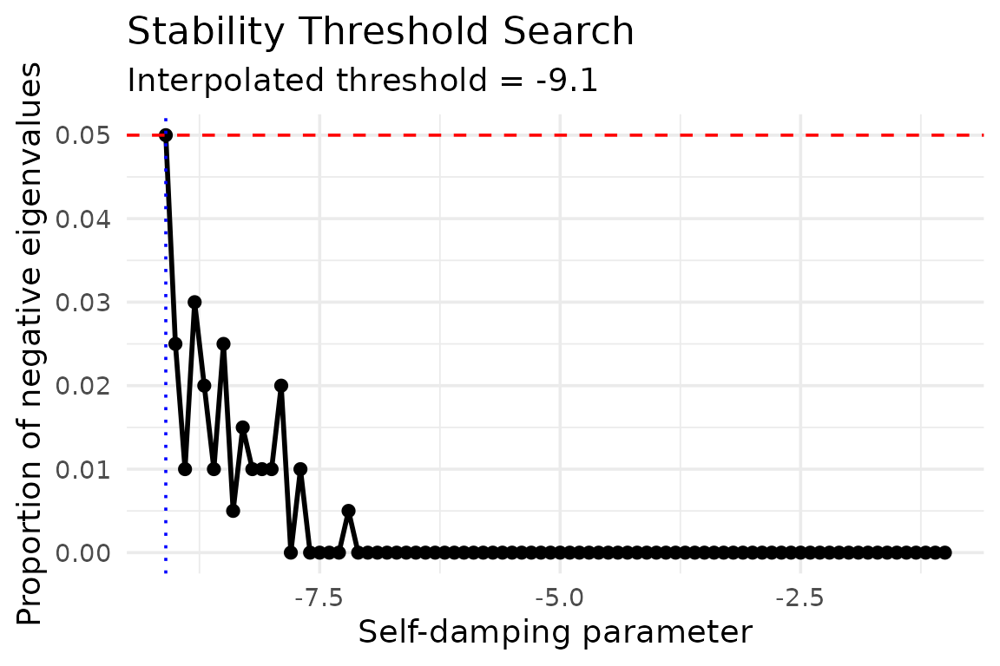

# Multiweb

``` r

library(multiweb)
```

## Overview

The `multiweb` package provides tools for analyzing and comparing
ecological networks, particularly food webs and multiplex networks,
through a set of reproducible and customizable functions. It allows for
the computation of structural and dynamic properties, module detection,
species roles, trophic positions, entropy- and centrality-based metrics,
structural stability thresholds, and extinction simulations. Multiplex
(multilayer) networks are supported throughout, including aggregation,
interactive visualization, and 3D layer rendering.

This vignette introduces the general structure of the package and
showcases typical usage patterns.

## Data Structure

The `multiweb` package works with an individual network and many
functions accept **lists of network objects**, where each network is
typically a food web represented by a directed graph. The preferred
format is a list of `igraph` objects, where each node is a species and
directed edges represent trophic links.

``` r

data("netData")  # A list of food web networks included in the package
net <- netData[[23]]
plot_troph_level_ggplot(net)
```



## Basic Metrics

### Global metrics

You can calculate a set of **global network metrics** such as number of
species (S), connectance (C), mean trophic level using:

``` r

metrics_all <- calc_topological_indices(netData)
head(metrics_all)
#>              Network Size Top Basal  Omnivory Links       LD Connectance
#> 1             Angola   28   4     2 0.7500000   127 4.535714  0.16198980
#> 2         Baltic Sea   33   4     4 0.4848485   191 5.787879  0.17539027
#> 3 Barents Sea Arctic  159  43     7 0.5911950   848 5.333333  0.03354298
#> 4 Barents Sea Boreal  180  22     6 0.6722222  1546 8.588889  0.04771605
#> 5         Beach Peru   46  20     5 0.3043478    88 1.913043  0.04158790
#> 6     Beagle Channel  145  11    36 0.5517241  1115 7.689655  0.05303210
#>   PathLength Clustering Cannib   TLmean    TLmax  LOmnivory Components
#> 1   1.608333 0.35763293      3 2.897171 4.039211 0.21066115          1
#> 2   1.413115 0.30550459      7 2.393618 3.678314 0.12726540          1
#> 3   2.056762 0.16540420     10 2.843582 5.190582 0.15941579          1
#> 4   2.280036 0.24859772     23 3.002873 4.796090 0.22714502          1
#> 5   1.733032 0.09312639      0 2.633627 4.162698 0.07312069          1
#> 6   2.121089 0.22267298      0 2.376811 4.120973 0.22045506          1
#>   Vulnerability     VulSD Generality     GenSD
#> 1      5.291667 0.9515706   4.884615 0.5954786
#> 2      6.586207 0.7377881   6.586207 0.9311804
#> 3      7.310345 1.6540281   5.578947 1.0462268
#> 4      9.784810 1.2292073   8.885057 1.3645655
#> 5      3.384615 1.3800444   2.146341 0.8452183
#> 6      8.320896 1.2057445  10.229358 1.2296630
```

### Modularity and Communities

Detect modules for a list of networks using any of the algorithms in
igraph or **Infomap** (requires the installation of infomap in the
system from <https://www.mapequation.org/infomap/#Install>). By default
it uses the cluster_spinglass algorithm from igraph.

``` r

mod <- calc_modularity(netData, cluster_function = run_infomap, directed = TRUE)
mod$network_name <- names(netData)
head(mod) 
#>   Modularity       network_name
#> 1 0.07638415             Angola
#> 2 0.05315096         Baltic Sea
#> 3 0.14248982 Barents Sea Arctic
#> 4 0.01091119 Barents Sea Boreal
#> 5 0.39617769         Beach Peru
#> 6 0.12863963     Beagle Channel
```

You can visualize the modular structure using:

``` r

mod  <- run_infomap(net)
plot_troph_level_ggplot(net, modules = TRUE, community_obj = mod)
```



## Topological Roles

You can compute species’ **topological roles** and plot them:

``` r

mod  <- run_infomap(net)
roles <- calc_topological_roles(net, community = mod)
roles_class <- classify_topological_roles(roles, net, community = mod)
head(roles_class$hub_conn)
#>   node            node_name   type within_module_degree among_module_conn
#> 1    7 Ophionotus victoriae modhub            2.9821909         0.1757812
#> 2   28     Benthic Diatomea modhub            2.8387437         0.3827160
#> 3   50       Fresh detritus modhub            2.9821909         0.4943311
#> 4    4  Gitanopsis squamosa modcon           -0.8893297         0.6875000
#> 5    6    Notothenia rossii modcon           -0.7369574         0.6603212
#> 6   10           Gammaridea modcon            0.5435892         0.6404959
roles_class$gp
```



## Entropy and Complexity

Quantify network complexity with **singular value decomposition (SVD)
entropy**:

``` r

svd_ent <- calc_svd_entropy(net)
svd_ent
#> $Rank
#> [1] 56
#> 
#> $Entropy
#> [1] 0.9092102
```

This metric is useful for comparing structural complexity across
multiple networks.

### Centrality measures

[`calc_centrality()`](https://lsaravia.github.io/multiweb/reference/calc_centrality.md)
generalizes centrality calculation to any centrality function available
in `igraph` (eigenvector centrality, PageRank, betweenness, degree,
etc.), returning both a ranked table and a plot of the top species:

``` r

cent <- calc_centrality(net, centrality_func = igraph::page_rank)
head(cent$CentralityScores)
#> # A tibble: 6 × 2
#>   Species                 Centrality
#>   <chr>                        <dbl>
#> 1 Chaenocephalus aceratus     0.0976
#> 2 Urticinopsis antarctica     0.0976
#> 3 Notothenia coriiceps        0.0931
#> 4 Notothenia rossii           0.0397
#> 5 Trematomus bernacchii       0.0374
#> 6 Harpagifer antarcticus      0.0312
cent$Plot_Centrality
```



### Detailed SVD importance

A more detailed decomposition of network complexity is available through
[`calc_svd_entropy_importance()`](https://lsaravia.github.io/multiweb/reference/calc_svd_entropy_importance.md),
which — in addition to entropy and rank — reports each species’
contribution to the dominant singular value (i.e. its structural
importance as prey and as predator):

``` r

svd_imp <- calc_svd_entropy_importance(net)
svd_imp$Entropy
#> [1] 0.9092102
svd_imp$Plot_Prey_Importance
```



## Randomizations and Null Models

The package includes tools for generating **null models** maintaining
the degree distribution (Curve ball algorithm):

``` r

rand_net <- curve_ball(net)
rand_metrics <- calc_modularity(rand_net, cluster_function = cluster_walktrap)

# Example: show distribution of connectance (C) and empirical value
library(ggplot2)
empirical_m <- calc_modularity(net, cluster_function = cluster_walktrap)$Modularity
ggplot(rand_metrics, aes(x = Modularity)) +
  geom_density(fill = "grey", color = "black") +
  geom_vline(xintercept = empirical_m, color = "salmon", linetype = "dashed", linewidth = 1) +
  theme_bw() +
  labs(title = "Distribution of Modularity in Randomized Networks",
       x = "Modularity")
```



or using the **niche model** to generate random networks with the same
size and connectance:

``` r


S <- metrics_all[23,"Size"]
C <- metrics_all[23,"Connectance"]
rand_net <- generate_niche(S,C,nsim=1000)
rand_metrics <- calc_modularity(rand_net, cluster_function = cluster_walktrap)

# Example: show distribution of connectance (C) and empirical value
library(ggplot2)
empirical_m <- calc_modularity(net, cluster_function = cluster_walktrap)$Modularity
ggplot(rand_metrics, aes(x = Modularity)) +
  geom_density(fill = "grey", color = "black") +
  geom_vline(xintercept = empirical_m, color = "salmon", linetype = "dashed", linewidth = 1) +
  theme_bw() +
  labs(title = "Distribution of Modularity in Randomized Networks",
       x = "Modularity")
```



You can then use these null models to assess the significance of
observed metrics.

### Calculation of interaction intensity and weighted metrics

Here we calculate interaction intensity using body mass and density data
from the Potter Cove food web (data included in the package) and
estimate weighted topological indices.

``` r

pc_i <- calc_interaction_intensity(
  PotterCove_bm,
  res_mm = r_bodymass,
  res_den = r_density,
  con_mm = c_bodymass,
  int_dim = D
)

# Build igraph object with weights from interaction strengths
g <- graph_from_data_frame(
  d = pc_i %>% dplyr::select(resource, consumer, weight = qRC),
  directed = TRUE
)

# Now compute weighted indices
calc_weighted_topological_indices(g)
#>        wLD wConnectance  wTLmean   wTLmax wLOmnivory wVulnerability  wVulSD
#> 1 9.061722   0.08237929 2.015625 3.763807 0.07262355       12.25968 4.99523
#>   wGenerality   wGenSD
#> 1    5.863761 3.124224
```

### Alternative interaction intensity estimation (O’Gorman 2010)

As an alternative to the body-mass/density approach above — useful when
resource density data are unavailable —
[`calc_interaction_intensity2()`](https://lsaravia.github.io/multiweb/reference/calc_interaction_intensity2.md)
estimates interaction strength from predator body mass and the number of
resources per consumer, following O’Gorman et al. (2010):

``` r

edge_list <- tibble::tibble(
  predator = c("A", "A", "B", "C"),
  prey = c("B", "C", "D", "D"),
  predator_mass = c(10, 10, 5, 3)
)

calc_interaction_intensity2(
  edge_list,
  consumer_n = predator,
  resource_n = prey,
  bodymass_n = predator_mass,
  output_format = "edgelist"
)
#> # A tibble: 4 × 3
#>   predator prey      qRC
#>   <chr>    <chr>   <dbl>
#> 1 A        B     0.00281
#> 2 A        C     0.00281
#> 3 B        D     0.00669
#> 4 C        D     0.00760
```

## Using multiplex networks

The package also supports **multiplex networks**, where multiple types
of interactions are represented as layers. You can create a multiplex
object and compute metrics across layers.

``` r


fpath <- system.file("extdata", package = "multiweb")
dn <- list.files(fpath,pattern = "^Kefi2015.*\\.txt$")
mnet <- readMultiplex(dn,c("Negative","Positive","Antagonistic"),fpath,skipColum=2)
```

You can then compute metrics like modularity for the entire multiplex
structure, in this case using the interface to info_map algorithm.

``` r


mod_multi <- run_infomap_multi(mnet)
head(mod_multi$communities)
#>   module                   node layer        flow
#> 1      6     acanthocyclus gayi     1 0.002427980
#> 2      6 acanthocyclus hassleri     1 0.002413950
#> 3      7       chiton  granosus     1 0.000546136
#> 4      7    fissurella  costata     1 0.000000000
#> 5      7     fissurella  crassa     1 0.000615915
#> 6      7    fissurella  limbata     1 0.000000000

plots <- plot_multiplex_modules(mnet, mod_multi$communities)
cowplot::plot_grid(plotlist = plots, ncol = 3)
```



Layers sharing the same node set can be combined into a single aggregate
network — summing edge weights where interactions coincide across layers
— which is useful as a common backbone for layout or as an approximation
of overall interaction load.
[`harmonize_node_sets()`](https://lsaravia.github.io/multiweb/reference/harmonize_node_sets.md)
first ensures every layer shares the same set of nodes (adding isolated
nodes where needed) before aggregating:

``` r

mnet_named <- mnet
names(mnet_named) <- c("Negative", "Positive", "Trophic")
mnet_named <- harmonize_node_sets(mnet_named)
agg_net <- aggregate_multiplex_network(mnet_named)
agg_net
#> IGRAPH 418daf4 DNW- 106 4554 -- 
#> + attr: name (v/c), weight (e/n)
#> + edges from 418daf4 (vertex names):
#>  [1] acanthina monodon ->concholepas concholepas            
#>  [2] acanthina monodon ->corallina offcinalis var. chilensis
#>  [3] acanthina monodon ->gelidium spp.                      
#>  [4] acanthina monodon ->gulls                              
#>  [5] acanthina monodon ->heliaster helianthus               
#>  [6] acanthina monodon ->perumytilus purpuratus             
#>  [7] acanthina monodon ->semimytilus algosus                
#>  [8] acanthocyclus gayi->acanthocyclus gayi                 
#> + ... omitted several edges
```

For a 3D view of all layers stacked together,
[`plot_multi3D()`](https://lsaravia.github.io/multiweb/reference/plot_multi3D.md)
(adapted from the `muxViz` project) renders each layer as a
semi-transparent plane using `rgl`, optionally with an aggregate layer
on top. This opens an interactive OpenGL device, so it is best explored
in an active R session rather than rendered here:

``` r

plot_multi3D(
  g.list = mnet_named,
  layer.colors = RColorBrewer::brewer.pal(3, "Set2"),
  node.colors = "auto",
  node.size.scale = 0.5,
  show.aggregate = TRUE
)
```

## Structural Stability (QSS)

### Estimating the stability threshold

Real food webs must be dynamically stable, which requires some minimal
level of intraspecific self-regulation (self-damping). Because the true
amount of self-regulation is rarely known,
[`calc_stability_threshold()`](https://lsaravia.github.io/multiweb/reference/calc_stability_threshold.md)
searches for the `selfDamping` value at which a target proportion of
simulated community matrices (Jacobians) become unstable — by default,
5% negative-eigenvalue crossings — using \[calc_QSS()\] internally.
Lower (more negative) thresholds indicate networks that require less
self-regulation to remain stable:

``` r

stab <- calc_stability_threshold(net, nsim = 200, ncores = 1, verbose = FALSE)
stab$threshold
#> [1] -9.1
```

The search trajectory can be visualized directly:

``` r

plot_stability_curve(stab)
```



### Extinction simulations

`multiweb` also provides tools to evaluate how the loss of one or more
species affects structural stability, by comparing QSS distributions
before and after deletion — useful for identifying keystone species or
estimating robustness to targeted or random extinctions.

To compare the whole network against the network without a given set of
species:

``` r

sp_sample <- V(net)$name[1:3]
ext_grp <- calc_QSS_extinction_dif_grp(net, sp_sample, nsim = 100, ncores = 1)
head(ext_grp)
#>   Size Connectance Components  QSS_all  QSS_ext      difQSS
#> 1  107  0.05074679          1 4.217772 3.431252  0.78651972
#> 2  107  0.05074679          1 4.631053 3.549625  1.08142898
#> 3  107  0.05074679          1 3.661623 4.290002 -0.62837823
#> 4  107  0.05074679          1 3.267733 3.161097  0.10663576
#> 5  107  0.05074679          1 4.230894 4.153084  0.07780978
#> 6  107  0.05074679          1 4.403984 3.234259  1.16972457
```

To simulate an incremental extinction sequence (species removed one at a
time, without secondary extinctions):

``` r

ext_seq <- calc_QSS_extinctions_seq(net, sp_sample, nsim = 100, ncores = 1)
head(ext_seq)
#>      maxre Size Connectance Components Last_deleted
#> 1 3.791120  110  0.05363636          1        Total
#> 2 3.843248  110  0.05363636          1        Total
#> 3 4.438879  110  0.05363636          1        Total
#> 4 4.351607  110  0.05363636          1        Total
#> 5 4.633743  110  0.05363636          1        Total
#> 6 3.466485  110  0.05363636          1        Total
```

Note: `nsim` and `ncores` are set low here for a fast-running vignette;
for actual analyses, larger `nsim` (e.g. 1000) and more cores are
recommended for stable estimates.

## Interactive Visualization

For exploratory work, `multiweb` provides interactive, draggable network
visualizations built on `visNetwork`, as an alternative to the static
`ggplot2`/`ggraph` plots shown above. Nodes are still organized by
trophic level on the y-axis, but can be dragged, zoomed, searched, and
hovered for details.

``` r

plot_troph_level_visNet(net, modules = TRUE)
```

For multiplex networks,
[`plot_troph_level_visNet_multi()`](https://lsaravia.github.io/multiweb/reference/plot_troph_level_visNet_multi.md)
overlays all interaction layers on the same trophic-level plot,
computing trophic level only from the designated trophic layer, with
distinguishable edge colors/styles per layer, an interactive layer
filter, and a legend:

``` r

plot_troph_level_visNet_multi(
  mnet_named,
  trophic_layer = "Trophic",
  layer_dashed = c("Negative", "Positive")
)
```

Note: when knitting to HTML these render as interactive embedded
widgets; if the vignette is exported to PDF for external documentation
(e.g. as supporting material), interactivity will be lost and a static
screenshot may be preferable.
